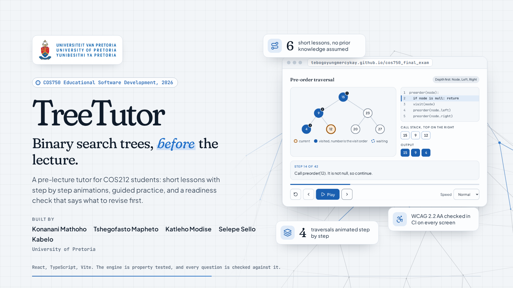

# Contributing

> Thank you for your interest in improving TreeTutor.

Bug reports, questions and suggestions all help, and this guide explains how to make them count.

## Before You Start

This repository is part of an assessed University of Pretoria project (COS750, 2026). Issues and suggestions are welcome at any time, but code changes from outside the team may not be merged until the project has been assessed, because the work is examined as the team's own.

## Reporting Issues

Open a GitHub issue that says what you did, what you expected and what happened. Include the screen or lesson, the browser and device, whether the light or dark theme was on, and a screenshot if it helps. Security issues go through the [Security Policy](SECURITY.md) instead.

## Making a Change

1. Branch from `develop`, as `feat/...`, `fix/...` or `docs/...`.
2. Follow the [Coding Standards](docs/coding-standards.md), in particular its correctness rules.
3. Run `./forge all` and make sure everything passes. Add a regression test for any bug you fix. The [Development Guide](docs/development.md) explains each command.
4. If you change lesson content, the content tests must still pass. Fix the content, never loosen the test to fit it.
5. Open a pull request into `develop` with a one-line summary and a few bullets of changes, and merge it with a merge commit. `develop` is merged into `master` after review.

New to pull requests? See [GitHub's guide to pull requests](https://docs.github.com/en/pull-requests).

## Commit Messages

Use a conventional prefix, `feat:`, `fix:`, `docs:`, `chore:`, `test:` or `refactor:`, followed by a short imperative description in lower case, for example `fix: keep the visit order badge readable on the current node`.

## Community Guidelines

Everyone taking part is expected to follow the [Code of Conduct](CODE_OF_CONDUCT.md).

## Getting Help

Open a GitHub issue with your question. The [Development Guide](docs/development.md) answers the most common setup ones.

---

_COS750 Educational Software Development, University of Pretoria, 2026._
