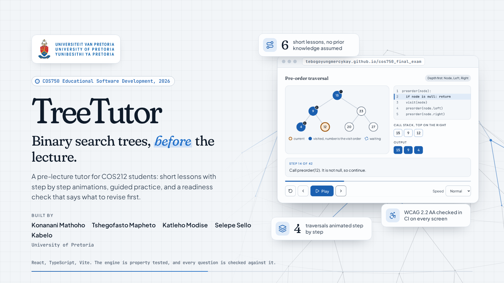

# TreeTutor

  

> Learn binary search trees before the lecture, one step at a time. TreeTutor takes COS212 students who have never met the topic through six short lessons, animates search, insert and every traversal step by step, lets them try each idea on real trees, and ends with a readiness check that says which parts of the lecture they are ready for and what to practise first.

Try it at [tebogoyungmercykay.github.io/cos750_final_exam](https://tebogoyungmercykay.github.io/cos750_final_exam/), or read the [project plan](docs/plan.md) for the scope and approach.

---

## Documentation

| Doc                                          | Description                                                                   |
| -------------------------------------------- | ----------------------------------------------------------------------------- |
| [Project Plan](docs/plan.md)                 | Scope, learners, approach and milestones                                      |
| [Development Guide](docs/development.md)     | Running, testing and building with `forge`, the layout and the CI/CD pipeline |
| [Coding Standards](docs/coding-standards.md) | Project structure, code style, comments, tests and correctness rules          |
| [Contributing](CONTRIBUTING.md)              | How to raise issues and changes, branches and commit messages                 |
| [Code of Conduct](CODE_OF_CONDUCT.md)        | Expected behaviour in this project's spaces                                   |
| [Security Policy](SECURITY.md)               | How to report a vulnerability privately                                       |

---

Released under the [MIT License](LICENSE).

_COS750 Educational Software Development, University of Pretoria, 2026. Konanani Mathoho, Tshegofasto Mapheto, Katleho Modise, Selepe Sello and Kabelo._
