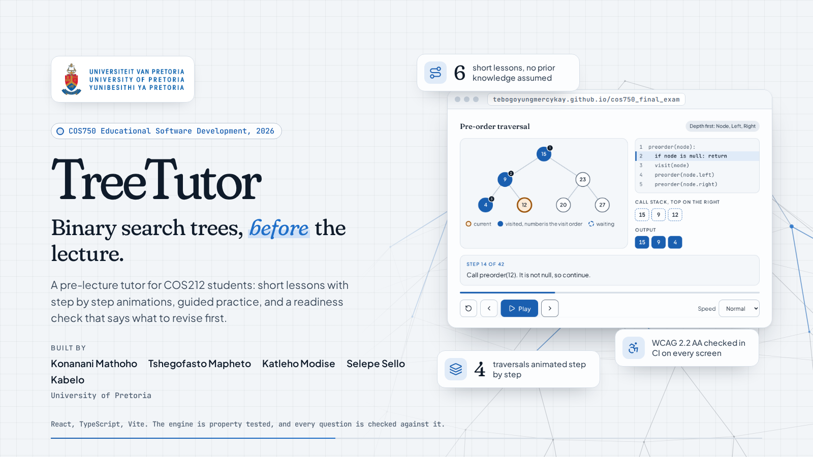

# Security Policy

> Responsible disclosure for the TreeTutor pre-lecture tutor prototype.

## Scope

This repository is a university prototype. The code in it, the CI/CD workflows and the live site at [tebogoyungmercykay.github.io/cos750_final_exam](https://tebogoyungmercykay.github.io/cos750_final_exam/) are in scope. The site is static, served by GitHub Pages, with no server and no accounts. A learner's first name and progress are kept only in their own browser's local storage and are never sent anywhere. GitHub Pages itself is out of scope here.

## Reporting a Vulnerability

**Please do not report security vulnerabilities through public GitHub issues.**

Report them privately through GitHub instead, from the **Security** tab of this repository, using **Report a vulnerability**. Only the maintainers can see the report.

## What to Include

- A description of the vulnerability and its potential impact
- Steps to reproduce it, or a proof of concept if it is safe to share
- The affected file, workflow or page of the site
- Any mitigation or fix you have in mind

## What to Expect

This is a student group project, so responses are best effort. You can expect an acknowledgement within a week and an update once the issue has been assessed. Valid issues are fixed on `master` and redeployed, and you are credited in the fix if you wish.

## Keeping Secrets Out

Never commit tokens, keys, `.env` files or other secrets. Nothing in the repository needs credentials to build, test or run, and the deploy uses the short-lived token GitHub Actions provides.

## Safe Harbour

Good-faith research that follows this policy and avoids privacy violations, data destruction and service disruption is welcome.

---

_COS750 Educational Software Development, University of Pretoria, 2026._
