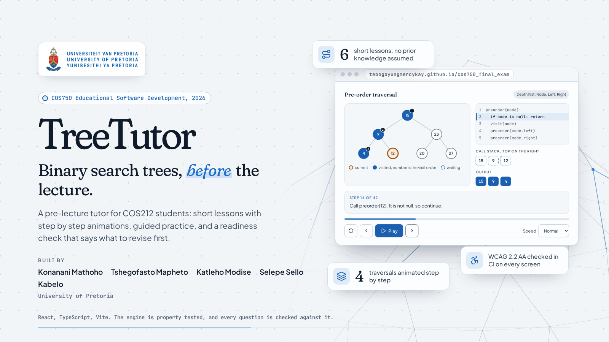

# Coding Standards



How code, tests and documentation are written in this repository. The aim is that a learner can never see an animation, a question and an answer key that disagree, that every screen works from the keyboard and a screen reader, and that a reviewer can trace every claim in the documents to code or a test.

### Table of Contents

1. [Project structure](#project-structure)
2. [TypeScript and React style](#typescript-and-react-style)
3. [Comments](#comments)
4. [Correctness rules](#correctness-rules)
5. [Tests](#tests)
6. [The interface](#the-interface)
7. [Git, branches and commits](#git-branches-and-commits)
8. [Documentation](#documentation)

## Project structure

```
cos750_final_exam/
├── treetutor                   # run script: setup, dev, test, e2e, lint, format, build, check, all
├── .github/workflows/
│   ├── ci.yml                  # treetutor check, treetutor e2e, then deploy to GitHub Pages from master
│   └── push.yml                # flags pushes to master or develop that are not merges
├── docs/                       # guides, see the README's documentation table
│   └── assets/                 # images used by the docs
└── app/
    ├── index.html
    ├── vite.config.ts          # build, plus Vitest and its coverage thresholds
    ├── playwright.config.ts    # end to end tests against the production build
    ├── e2e/
    │   └── app.spec.ts         # journeys, keyboard use, axe scans of every screen in both themes
    └── src/
        ├── engine/             # plain TypeScript, no React
        │   ├── bst.ts          # immutable tree operations and queries
        │   ├── traversal.ts    # the queue and stack frontiers, depth first orders and levels
        │   ├── traces.ts       # step traces, Java code and line notes for search, insert, traversals and the frontier loop
        │   ├── layout.ts       # node and empty-slot positions for drawing
        │   └── random.ts       # seeded randomness and random trees
        ├── content/            # lessons and questions as data
        │   ├── modules.tsx     # learning outcomes and the six lessons
        │   ├── assessment.ts   # warm-up, question bank, generators, readiness set
        │   ├── badges.ts
        │   ├── gagne.ts        # the Gagné event each section plays, and which events a lesson covers
        │   ├── modes.ts        # what standard and guided mode change, the one description of each
        │   ├── playground.ts   # presets, operations, and the animation each outcome is reviewed with
        │   ├── tours.ts        # the guided tours, per screen and per mode
        │   └── types.ts
        ├── state/
        │   ├── progress.ts     # saved progress, its types and the useProgress hook
        │   ├── ProgressProvider.tsx
        │   ├── scoring.ts      # credit, mastery and the readiness threshold
        │   ├── rng.ts          # randomness for generated questions; ?seed=42 makes a demo repeat
        │   ├── router.ts       # hash routes
        │   └── tour.ts         # which tour is showing, and which are waiting
        ├── components/         # tree view, step player, question card, lesson parts, tour, shell, background; reveal.ts
        ├── screens/            # one file per screen
        ├── styles.css          # design tokens and every style
        └── test/setup.ts
```

Logic lives in `engine/`, `content/` and `state/` and is imported by components. Components render and handle input; they do not compute answers. A new lesson is data in `content/`, not a new component.

## TypeScript and React style

- TypeScript in strict mode. No `any`, and non-null assertions only where the value is known to exist.
- `PascalCase` for components and types, `camelCase` for functions and variables, `UPPER_CASE` for module constants such as `READY` or `TREES`.
- Prettier formats everything: no semicolons, single quotes, lines up to 120 characters. Run `./treetutor format` rather than formatting by hand.
- oxlint runs with warnings as errors. Two React rules matter most: never read or write a ref during render, and never call `setState` straight inside an effect. Derive the value during render instead, or use React's pattern of adjusting state when a prop changes.
- A file that exports a component exports only components. Hooks, constants and types that sit alongside a provider live in their own `.ts` file, as `progress.ts` does for `ProgressProvider.tsx`.
- Reuse what exists before adding a file or a helper. New modules are for genuinely new responsibilities.

## Comments

Comments document the code, not the task that produced it. A comment must be true and useful to someone who reads only the file, with no memory of how or why the code was written and no knowledge of the request behind it. The rule is the same in every layer of this repository: the TypeScript and CSS in `app/`, the `treetutor` script, the workflows in `.github/` and the configuration files. Only the comment syntax changes.

### What a comment is for

Comments exist for two things only.

- **Non-obvious rationale.** Why this approach, why this edge case, why this workaround, why this order. Logic or intent that cannot be recovered by reading the code. For example, from the engine:

  ```ts
  /**
   * Children are pushed right to left so the left child sits on top. This keeps
   * the search loop identical for both frontiers while depth first still
   * explores the left subtree first, matching pre-order.
   */
  ```

- **Section separators** for navigation in long files, such as `styles.css` or the `treetutor` script:

  ```css
  /* ========================================================================== */
  /* Trees                                                                      */
  /* ========================================================================== */
  ```

  ```bash
  # --- argument parsing ---------------------------------------------------------
  ```

### What a comment is not for

- **Narrating the change.** "Same as the block above", "added to support the playground", "now uses the engine", "while the lessons are being written". These describe the diff or the task, not the code. Anything that points at another place in the file, an issue, a pull request, a conversation, or a state in time belongs in the commit message or the pull request description.
- **Restating what is visible.** Listing which functions, props or fields exist, or describing what the next few lines plainly do. If the code already shows it, the comment is redundant. Do not caption the code.
- **Tutorial asides.** Explaining standard TypeScript, React, CSS, bash or GitHub Actions behaviour that anyone working in this repository is expected to know.
- **Review notes and to-do markers.** They never reach `develop` or `master`.

### The test

Before writing a comment, ask: _would this sentence still be true and useful if the surrounding code were the only thing that ever existed?_ If it leans on "above", "now", "currently", "was added because" or any other reference to process or time, rewrite it as a stable statement about the code, or delete it.

The same rule applies to the content of commit messages in reverse: they describe what the commit changes, and nothing else.

## Correctness rules

1. **The engine is the single source of truth.** Animations, generated questions and marking all call the engine. Never hand-type an answer the engine can compute.
2. **Trees are immutable.** Every operation returns a new tree and leaves its input untouched; an insert of an existing key returns the same object.
3. **Authored content must agree with the engine.** Every question passes the content tests: answers exist in their trees, a "valid BST?" answer matches `firstViolation`, and any traversal written out in an explanation equals `traversalOrder`. Fix the content, never the test.
4. **Every outcome stays aligned.** Each learning outcome has one lesson with a guided try, a reflection, takeaways and a checkpoint of at least four questions, plus bank items and a generator for the readiness check. Every question carries a Bloom level, and it must be one of its outcome's levels. Every wrong multiple choice option has feedback aimed at the misconception behind it. Every lesson covers all nine of Gagné's events, including a recall of prior learning and a worked example. The content tests enforce all of this.
5. **Randomness is injected.** Anything random takes an `Rng` argument. Tests pass `seeded(n)` so every failure can be replayed, and screens pass `appRng`, so `?seed=42` in the address makes every generated question repeat for a demonstration.
6. **Scoring lives in one place.** Credit per attempt, the 10-answer mastery window and the 70% readiness threshold are constants in `state/scoring.ts`, never literals in a screen.
7. **The code on screen is the code that runs.** Every animation step points at the line of Java that produces it, never the signature. A step that changes something carries a reason; a check that changes nothing is marked `detail`, so standard mode can skip it without losing state. The engine tests enforce all three.
8. **Nothing leaves the browser.** No server calls and no analytics. Every `localStorage` access is guarded, so the app still works when storage is blocked.

## Tests

- Vitest for unit, property and component tests, beside the code they test as `*.test.ts(x)`. fast-check for properties over random trees. Testing Library for components, queried by role and accessible name.
- Playwright and axe for end to end tests in `app/e2e/`, on desktop and mobile Chromium, against the production build.
- Coverage: the engine stays at 100%; other logic at 90% or more. Screens are covered by the end to end suite.
- Run `./treetutor check` before every commit and `./treetutor all` before merging. Every bug fix comes with a regression test that fails without the fix.
- Before saying an interface change is done, look at it in light, dark and on a phone. Automated scans do not see everything: the axe scan once passed while the visit order numbers inside the tree drawing were invisible.

## The interface

- Colours, fonts and shadows come from the tokens at the top of `styles.css` and mean the same thing everywhere: amber is the current node, blue is visited or chosen, green is found or correct, red is wrong or a broken rule.
- The app opens in the light theme. Dark is the learner's choice and is remembered.
- States are shown by shape as well as colour: filled, ringed, dashed.
- Icons come from Lucide. No emoji, sticker graphics or jokes in the copy.
- Every interactive element works from the keyboard, has an accessible name and a visible focus ring. Changes the learner should hear are announced through a live region.
- Motion respects `prefers-reduced-motion`, and the background animation pauses when the tab is hidden.
- The active choice in any group of choices looks like its hover state: accent text and an accent border, with no tick icon and no change of background. The state is also set as `aria-pressed`, `aria-checked` or a checked radio.
- When an action puts its result below the fold, the result scrolls into view and takes focus. Use `reveal()` from `components/reveal.ts` rather than scrolling by hand.
- What each support mode changes is described once, in `content/modes.ts`. Never describe a mode anywhere else.
- A new screen, or a new component with controls of its own, gets a tour in `content/tours.ts`, written for both modes, and a `TourLauncher`. Tour targets are `data-tour` attributes.
- Fonts are installed packages, not links to a font service, so the app works offline.

## Git, branches and commits

- `master` holds reviewed releases and is what deploys. `develop` collects finished work and is the default branch. Branch from `develop` as `feat/...`, `fix/...` or `docs/...`, open a pull request into `develop`, and merge `develop` into `master` after review.
- Merge with a merge commit. Squash and rebase merges, and direct pushes, fail the push check.
- A commit message is a subject line with a conventional prefix, `feat:`, `fix:`, `docs:`, `chore:`, `test:` or `refactor:`, and a short imperative description in lower case. A blank line follows, then bullets that each name a concrete change in the commit:

  ```
  feat: add the question card

  - Show hints in order after each mistake, or from the start in guided mode
  - Give partial credit per attempt and none for a revealed answer
  - Offer the answer only after three mistakes
  ```

- Messages summarise what is being committed. How the work came about, who asked for it and what was tried first stay out of the message.
- Merges keep Git's own message: `Merge branch 'feat/...' into develop`, and `Merge branch 'develop'` on `master`.
- Pull request descriptions are short: a one-line summary and a few bullets of changes.
- Never commit secrets, build output or private course material.

## Documentation

- Guides live in `docs/` as Markdown, linked from the README's documentation table.
- Prose uses plain punctuation, commas and full stops, with no dash punctuation, and British spelling (behaviour, colour, practise as a verb).
- Facts in the docs come from the code, a test or a recorded run, never from memory.

---

_COS750 Educational Software Development, University of Pretoria, 2026._
