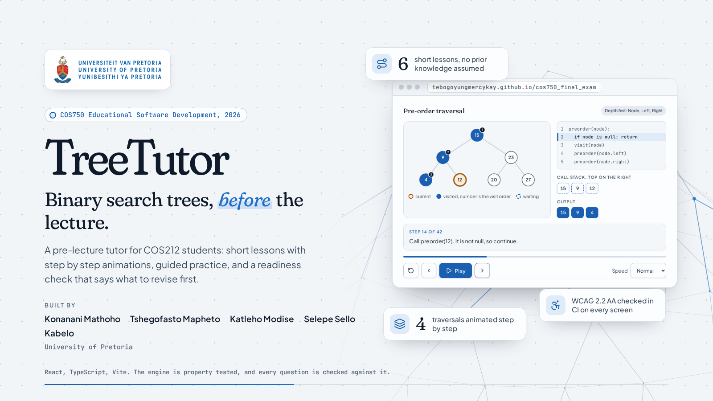

# Development Guide



> Running, testing and building TreeTutor, and how a change reaches the live site.

## Requirements

- Node 24 or later.
- bash. On Windows, use Git Bash or WSL.

## Run it

```bash
./treetutor setup     # install dependencies and the browser the end to end tests use
./treetutor dev       # http://localhost:5173
```

For a demonstration, open the app with a seed, for example `http://localhost:5173/?seed=42`. Every generated question then repeats in the same order after a reload, and the footer says the seed is on. Reset progress on the Progress page to start the demo from a clean state.

## The treetutor script

`./treetutor` runs everything from the repository root, and CI calls the same commands, so a green `./treetutor all` on your machine means the same checks pass on GitHub. `./treetutor --help` lists every option.

| Command                 | What it does                                                                                     |
| ----------------------- | ------------------------------------------------------------------------------------------------ |
| `./treetutor setup`     | Install the dependencies and Playwright's Chromium                                               |
| `./treetutor dev`       | Development server with hot reload                                                               |
| `./treetutor test`      | Unit, property and component tests; `--watch` reruns on change, `--coverage` enforces thresholds |
| `./treetutor e2e`       | End to end and accessibility tests on desktop and mobile; `--project mobile` for one             |
| `./treetutor lint`      | oxlint, warnings fail                                                                            |
| `./treetutor format`    | Prettier over the code and the docs; `--check` only reports                                      |
| `./treetutor typecheck` | TypeScript, nothing written                                                                      |
| `./treetutor build`     | Production build into `app/dist`                                                                 |
| `./treetutor preview`   | Build, then serve the production build                                                           |
| `./treetutor check`     | Everything CI checks before the browser tests                                                    |
| `./treetutor all`       | `check`, then the end to end tests: everything CI runs                                           |
| `./treetutor clean`     | Delete build and test output; `--all` also deletes `app/node_modules`                            |

Anything after `--` goes to the underlying tool, for example `./treetutor test -- src/engine` or `./treetutor e2e -- --grep keyboard`.

## How the app is put together

The engine in `app/src/engine/` is plain TypeScript with no React. The same step traces drive the animations, generate the practice questions and mark the learner's answers, so the picture on screen, the question and the answer key can never disagree. The engine is property tested against random trees.

Lesson content in `app/src/content/` is data. The content tests check every authored question against the engine, so a wrong answer key, or a traversal order typed incorrectly in an explanation, fails the build. They also check that every learning outcome has a lesson, a guided try, a reflection and a checkpoint.

Progress stays in the learner's browser. There is no server and no account.

## CI/CD

[`.github/workflows/ci.yml`](../.github/workflows/ci.yml) runs on every push to any branch and on every pull request, so a feature branch is checked before its pull request is opened:

1. `./treetutor check`: lint, format check, typecheck, unit tests with coverage (engine 100%, other logic 90%), build
2. `./treetutor e2e`: Playwright and axe on desktop and mobile Chromium
3. on a push to `master` or `main` only, and only when 1 and 2 pass: deploy `app/dist` to GitHub Pages

[`.github/workflows/push.yml`](../.github/workflows/push.yml) marks a push to `master` or `develop` as failed when its head commit is not a merge, so changes arrive through pull requests or merge commits.

One time repository setup:

- **Pages:** Settings, Pages, Build and deployment, Source set to GitHub Actions.
- **Deploy branch:** Settings, Environments, `github-pages`, Deployment branches and tags, with a rule for `master` and one for `main`. A deploy from a branch without a rule is rejected.
- **Branch protection:** a ruleset on `master` and `develop` requiring a pull request and both CI check jobs.

## Branches

`master` is what is deployed. `develop` is where work is integrated and is the default branch. Each task gets a `feat/...`, `fix/...` or `docs/...` branch from `develop` and comes back through a pull request. Merge with a merge commit, never squash or rebase, so the push check passes. `develop` is merged into `master` to release.

---

_COS750 Educational Software Development, University of Pretoria, 2026._
